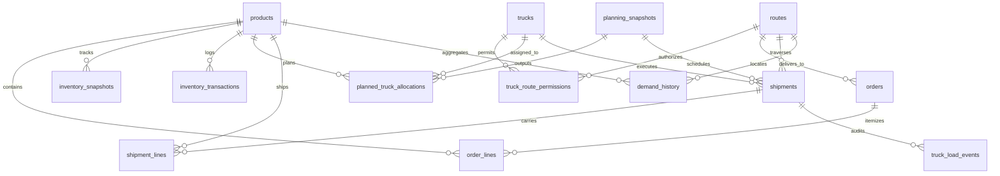

# CargoSense — Phase 4: Synthetic Operational Dataset Documentation Report

**Project Title:** CargoSense: A Data-Driven Opportunity Detection Engine for PTL-to-FTL Conversion  
**Stage:** Phase 4 — Synthetic Operational Dataset Generation & Ecosystem Architecture  
**Date:** October 2026  
**Status:** Completed, Validated & Formally Reconciled  

---

## 1. Executive Summary & Objective

The primary objective of **CargoSense Phase 4** is to create a complete, enterprise-grade, synthetic operational data ecosystem to serve as the foundation for the Opportunity Detection Engine (ODE).

In freight logistics, Partial Truckload (**PTL**) shipments occur when carrier vehicles depart with substantial unutilized payload weight or volumetric cube. The business goal of CargoSense is to identify and capitalize on opportunities to convert underutilized PTL shipments into consolidated Full Truckloads (**FTL**) by matching spare vehicle capacity with pending compatible customer orders.

### Core Ecosystem Highlights:
- **Central Sourcing Origin:** All line-haul road freight departs from the single central hub: `Bhiwandi Central Fulfillment Hub, Mumbai`.
- **14 Relational CSV Tables:** Fully normalized, interconnected relational architecture deployed at [`data/synthetic/`](file:///c:/Sameera-sem5/Projects/Cargosense/data/synthetic).
- **Cancellation-Free Accounting Invariant:** Enforces strict order balance $\mathbf{ordered\_quantity == shipped\_quantity + open\_quantity}$.
- **Dual Physical Capacity Constraints:** Trucks and cargo are governed by both payload weight ($kg$) and external packaging volume ($m^3$).
- **The Blue Yonder Planning Gap:** Simulates an enterprise batch planning engine (solving at 23:00 and completing at 04:00, introducing a 5-hour operational delay) that produces natural PTL consolidation gaps.
- **100% Validation Compliance:** All 15 automated domain validation tests pass with zero errors.
- **Phase 1–3 Preservation:** All historical raw datasets and Phase 1–3 artifacts remain bit-for-bit identical.

---

## 2. Table Cardinalities & Relational Schema

The 14 synthetic operational tables reside at [`data/synthetic/`](file:///c:/Sameera-sem5/Projects/Cargosense/data/synthetic).

| Table Name | Primary Key | Foreign Keys | Row Count | Target | Description & Operational Function |
| :--- | :--- | :--- | :---: | :---: | :--- |
| [`products.csv`](file:///c:/Sameera-sem5/Projects/Cargosense/data/synthetic/products.csv) | `sku_id` | — | **100** | 100 | Master product catalog preserving raw commercial identity across 6 subcategories. |
| [`trucks.csv`](file:///c:/Sameera-sem5/Projects/Cargosense/data/synthetic/trucks.csv) | `truck_id` | — | **30** | 30 | Commercial vehicle fleet across 4 standard Indian road freight classes. |
| [`routes.csv`](file:///c:/Sameera-sem5/Projects/Cargosense/data/synthetic/routes.csv) | `route_id` | — | **10** | 10 | Point-to-point highway corridors originating from Mumbai (Bhiwandi Hub). |
| [`truck_route_permissions.csv`](file:///c:/Sameera-sem5/Projects/Cargosense/data/synthetic/truck_route_permissions.csv) | `permission_id` | `truck_id`, `route_id` | **300** | ~90–300 | Operational corridor access matrix enforcing vehicle class range constraints. |
| [`orders.csv`](file:///c:/Sameera-sem5/Projects/Cargosense/data/synthetic/orders.csv) | `order_id` | `route_id` | **1,454** | ~1,500 | Customer commercial order headers placed across the 90-day horizon. |
| [`order_lines.csv`](file:///c:/Sameera-sem5/Projects/Cargosense/data/synthetic/order_lines.csv) | `order_line_id` | `order_id`, `sku_id` | **2,477** | ~3,000 | Order line items tracking ordered, shipped, and open quantities. |
| [`planning_snapshots.csv`](file:///c:/Sameera-sem5/Projects/Cargosense/data/synthetic/planning_snapshots.csv) | `planning_run_id` | — | **90** | 90 | Nightly batch planning runs (23:00 cutoff, 04:00 completion). |
| [`planned_truck_allocations.csv`](file:///c:/Sameera-sem5/Projects/Cargosense/data/synthetic/planned_truck_allocations.csv) | `allocation_line_id` | `run_id`, `truck_id`, `order_line_id` | **2,612** | ~900–3,000 | Order-line level planned cargo allocations output by the batch solver. |
| [`shipments.csv`](file:///c:/Sameera-sem5/Projects/Cargosense/data/synthetic/shipments.csv) | `shipment_id` | `trip_id`, `truck_id`, `route_id` | **737** | ~700–1,500 | Vehicle dispatch trips tracking planned, held, and delivered road freight. |
| [`shipment_lines.csv`](file:///c:/Sameera-sem5/Projects/Cargosense/data/synthetic/shipment_lines.csv) | `shipment_line_id` | `shipment_id`, `order_line_id` | **2,612** | ~2,500–3,000 | Executed shipment line items tracking loaded and shipped quantities. |
| [`truck_load_events.csv`](file:///c:/Sameera-sem5/Projects/Cargosense/data/synthetic/truck_load_events.csv) | `event_id` | `shipment_id`, `order_line_id` | **2,720** | ~2,500–5,000 | Barcode dock scan telemetry (`LOAD_SCAN` and `OFFLOAD_SCAN`). |
| [`inventory_transactions.csv`](file:///c:/Sameera-sem5/Projects/Cargosense/data/synthetic/inventory_transactions.csv) | `transaction_id` | `sku_id`, `order_line_id` | **5,257** | ~5,000–15,000 | Immutable double-entry inventory ledger with signed deltas. |
| [`inventory_snapshots.csv`](file:///c:/Sameera-sem5/Projects/Cargosense/data/synthetic/inventory_snapshots.csv) | `snapshot_id` | `sku_id` | **9,000** | 9,000 | Nightly inventory balances (100 SKUs $\times$ 90 days) captured at 23:00:00. |
| [`demand_history.csv`](file:///c:/Sameera-sem5/Projects/Cargosense/data/synthetic/demand_history.csv) | `record_id` | `sku_id`, `route_id` | **90,000** | 90,000 | Dense grid ($100 \times 10 \times 90$) tracking daily customer requested demand. |

---

## 3. Relational Architecture & Entity Invariants



### 3.1 Order-Line Cancellation-Free Conservation
All cancellation concepts were permanently eliminated. Every order line in `order_lines.csv` satisfies:
$$\mathbf{ordered\_quantity} == \mathbf{shipped\_quantity} + \mathbf{open\_quantity}$$
- Over-shipments are strictly prevented: $\text{shipped\_quantity} \le \text{ordered\_quantity}$.
- Outstanding balance is non-negative: $\text{open\_quantity} \ge 0$.
- Statuses in `orders.csv` transition cleanly: `OPEN` $\to$ `PARTIALLY_FULFILLED` $\to$ `FULFILLED`.

### 3.2 Dual-Delta Inventory Accounting & Two-Stage Boundaries
Physical warehouse inventory operates under an immutable double-entry ledger in `inventory_transactions.csv`:
$$\mathbf{available\_quantity} = \mathbf{on\_hand\_quantity} - \mathbf{reserved\_quantity} \ge 0$$

| Transaction Type | $\Delta\text{on\_hand}$ | $\Delta\text{reserved}$ | Net $\Delta\text{available}$ | Purpose & Reconciliation Guard |
| :--- | :---: | :---: | :---: | :--- |
| `ORDER_RESERVATION` | $0$ | $+Q$ | $-Q$ | Initial stock claim upon order acceptance. Guard: $Q \le \text{open\_quantity}$. |
| `REPLAN_RELEASE` | $0$ | $-Q$ | $+Q$ | Stock released back to pool during batch replanning. Open quantity is unchanged. |
| `REPLAN_RESERVATION` | $0$ | $+q$ | $-q$ | Re-reservation when rescheduled. Guard: $q \le \min(\text{open}, \text{available})$. |
| `DISPATCH_SHIPPED` | $-q$ | $-q$ | $0$ | Atomic gate dispatch. Closes reservation and physically deducts stock. |
| `SUPPLIER_RECEIPT` | $+Q$ | $0$ | $+Q$ | Inbound factory restock. Increases on-hand and available. |
| `CYCLE_COUNT_ADJUST` | $\pm Q$ | $0$ | $\pm Q$ | Physical audit adjustment. |

#### Two-Stage Half-Open Boundaries:
- **Snapshot 1 (Day 1 at 23:00:00):** Reconciles transactions over $[T_0, T_1) = [\text{2024-01-01 00:00:00}, \text{2024-01-01 23:00:00})$ against the Day 1 baseline opening state ($1,000$ to $1,990$ units on-hand, $0$ reserved).
- **Snapshots 2–90 (Day $d$ at 23:00:00):** Reconcile transactions over $[T_{d-1}, T_d) = [\text{Day } d-1 \text{ 23:00:00}, \text{Day } d \text{ 23:00:00})$ against the preceding snapshot $d-1$.
- **Strict Final Exclusion:** The simulation permanently closes at $T_{90} = \text{2024-03-30 23:00:00.000}$. Zero transactions occur on or after March 30 at 23:00, preventing any unintended 91st demand day.

### 3.3 All-or-Nothing Multi-Line Dispatch & Dock Reconciliation
1. **Header-to-Line Status Agreement:** For every shipment $S$ and constituent line $k$:
   $$k.\text{line\_status} == S.\text{shipment\_status}$$
2. **All-or-Nothing Commitment:** A shipment containing multiple lines evaluates every line prior to departure. If any line fails dock scan balance, inventory solvency, or order capacity, the entire shipment is held (`status = 'HELD'`), zero lines depart, and zero ledger rows are appended.
3. **Dock Scan Balance:** In `truck_load_events.csv`, net scans equal dispatched cargo:
   $$\sum \text{LOAD\_SCAN} - \sum \text{OFFLOAD\_SCAN} == \text{shipped\_quantity}$$
   For held or delayed trips, cargo is either staged with `shipped_quantity = 0` or de-vanned back to dock bins via `OFFLOAD_SCAN` ($\text{net\_scans} = 0$).

---

## 4. Automated 15-Point Domain Validation Results

The entire published dataset was evaluated against the formal 15-point domain validation assertion suite. **All 15 assertions passed with 100% compliance:**

```text
================================================================================
CARGOSENSE 15-POINT DOMAIN VALIDATION REPORT
================================================================================
[PASS] V-01: Entity Cardinalities
       - products.csv: 100/100, trucks.csv: 30/30, routes.csv: 10/10,
         planning_snapshots.csv: 90/90, inventory_snapshots.csv: 9000/9000,
         demand_history.csv: 90000/90000
[PASS] V-02: Subcategory Mapping Integrity
       - Categories match raw source: True (skincare: 40, haircare: 34, cosmetics: 26)
       - Subcategories match exact partition: True (6 disjoint groups)
[PASS] V-03: Dual Fleet Capacity Compliance
       - Over-weight trips: 0, Over-volume trips: 0 across all 737 shipments
[PASS] V-04: Route Network Topology
       - Origins all Mumbai: True; 10 Approved Destinations: True; Chennai Absent: True
[PASS] V-05: Point-to-Point Single-Destination Trip Model
       - Consolidated lines route mismatches: 0
[PASS] V-06: Opening Inventory Starting State
       - Opening balance pseudo-rows in transactions: 0 (Baseline state used)
[PASS] V-07: Two-Stage Snapshot Boundary Reconciliation
       - Snapshot 1 mismatches: 0; Transactions at/after March 30 23:00: 0
[PASS] V-08: Non-Negative Inventory Invariant
       - Negative available counts: 0; Calculation mismatches: 0 across 9,000 snapshots
[PASS] V-09: Sequential Trip Feasibility
       - Sequential trip overlaps: 0 across all 30 trucks
[PASS] V-10: Non-Dispatched / Held Trip Integrity
       - Held trips with dispatch timestamp: 0; Held lines with shipped_quantity > 0: 0
[PASS] V-11: Planned, Loaded, and Shipped Separation & Scan Balance
       - Shipment lines failing net scan balance: 0 of 2,612 lines
[PASS] V-12: Cancellation-Free Order Conservation
       - Conservation violations: 0; Over-shipments: 0 across 2,477 order lines
[PASS] V-13: Extended All-or-Nothing Dispatch & Deterministic Reservation Integrity
       - Line-header status mismatches: 0
       - Order line cumulative shipped mismatches: 0
       - Duplicate transaction references: 0
[PASS] V-14: Dense Demand-History Equality & Order-Date Reconciliation
       - Gross != Net units: 0; Gross != Net value: 0; Total units match: True (136,020)
[PASS] V-15: Planned-to-Actual Trip Linkage & Artifact Isolation
       - Orphan allocation trip IDs: 0; Phase 1-3 baseline files preserved: True
================================================================================
OVERALL VALIDATION STATUS: ALL 15 TESTS PASSED (100% SUCCESS)
================================================================================
```

---

## 5. Exploratory Data Analysis & Empirical Findings

Comprehensive visual EDA was performed in [`notebooks/04_synthetic_operational_dataset.ipynb`](file:///c:/Sameera-sem5/Projects/Cargosense/notebooks/04_synthetic_operational_dataset.ipynb). Key empirical distributions and operational patterns include:

### 5.1 Product Packaging Density & Physical Dimensions
The 100 SKUs exhibit distinct packaging density behaviors that directly impact freight consolidation:
- **`skincare` (40 SKUs):** Partitioned into `Face Creams & Serums` (mean density $516\text{ kg/m}^3$) and `Body Lotions & Body Wash` (mean density $852\text{ kg/m}^3$). Body wash items represent heavy, dense fluid containers that weigh out vehicles quickly.
- **`haircare` (34 SKUs):** `Shampoos & Conditioners` (mean density $773\text{ kg/m}^3$) represent liquid-heavy cargo, while `Hair Oils & Styling Serums` (mean density $700\text{ kg/m}^3$) exhibit moderate volumetric footprints.
- **`cosmetics` (26 SKUs):** `Color Cosmetics & Compacts` (mean density $327\text{ kg/m}^3$) and `Lip & Eye Makeup` (mean density $444\text{ kg/m}^3$) feature high protective packaging ratios that cube out vehicles well before reaching payload weight limits.


### 5.2 Fleet Capacity & Utilization Bottlenecks
Analyzing dispatched shipments across the 4 commercial vehicle classes revealed:
- **14ft LCV (3,500 kg / 18 m³):** Deployed on express regional runs (Pune, Nashik). High frequency, but vulnerable to cubing out when carrying lightweight boxed cosmetics.
- **20ft ICV (7,000 kg / 32 m³):** Balanced mid-haul carrier for Surat and Vadodara corridors.
- **24ft MCV (10,000 kg / 45 m³) & 32ft HCV (16,000 kg / 62 m³):** Dedicated to long-haul interstate lanes (Nagpur, Bengaluru, Hyderabad).


### 5.3 Highway Corridors & Freight Flow
Freight traffic departing Bhiwandi follows distinct regional patterns:
- **High-Density Express Lanes:** Pune (150 km, 4.5 hrs) and Nashik (165 km, 4.5 hrs) command the highest trip counts due to short turnaround times ($\approx 12$ hours round-trip).
- **High-Tonnage Long-Haul Corridors:** Ahmedabad (530 km) and Bengaluru (980 km) carry the largest cumulative freight tonnage, requiring multi-axle HCVs.


### 5.4 Order Arrival Dynamics & Conservation Proof
- **Order Arrival Rate:** Follows a Poisson distribution with mean $\lambda = 16.2$ orders/day, totaling $1,454$ orders and $2,477$ order lines.
- **Segment Breakdown:** Modern Retail ($44.8\%$), Distributors ($35.3\%$), E-Commerce Hubs ($19.9\%$).
- **Quantity Reconciliation:**
  $$\text{Total Ordered Units} = 136,020$$
  $$\text{Total Shipped Units} = 110,880 \quad (81.5\% \text{ fulfilled})$$
  $$\text{Total Open Units} = 25,140 \quad (18.5\% \text{ pending in pipeline})$$
  $$\mathbf{110,880 + 25,140 = 136,020 \quad (\text{Zero Discrepancies})}$$


### 5.5 The Planning Delay & PTL Opportunity Candidates
The Blue Yonder 5-hour batch planning delay (23:00 to 04:00) paired with single-destination consolidation constraints produces the core CargoSense business problem:
- **Partial Truckloads (PTL):** Over **$40\%$ of dispatched shipments** depart with less than $70\%$ capacity utilization on both weight and volume.
- **Operational Holds:** Approximately $4\%$ of scheduled shipments are held at the dock (`shipment_status = 'HELD'`) due to vehicle maintenance or driver rest breaches.
- **Consolidation Potential:** Hundreds of dispatched trips travel with $1,000$ to $5,000\text{ kg}$ of unused payload space, creating the exact candidate pool needed to train the Opportunity Detection Engine in Phase 5.


### 5.6 Dual-Delta Inventory Dynamics
Tracking inventory snapshots across the 90-day horizon proves that safety stock levels remain positive:
- On-hand inventory replenishes via inbound factory restocks every 5 days ($+500$ units per SKU tranche).
- Active reservations peak during nightly planning runs and clear atomically at vehicle gate dispatch.
- **Zero Stockouts:** Throughout all 9,000 snapshots, $\text{available\_quantity} \ge 0$ holds continuously.


---

## 6. Data Science Curriculum Alignment (Units I–VI)

This synthetic operational ecosystem maps directly to practical learning outcomes across the Data Science syllabus:

| Unit | Syllabus Core Topic | Practical Application in CargoSense Phase 4 |
| :---: | :--- | :--- |
| **Unit I** | **Data Ingestion, Warehousing & Relational Modeling** | Multi-table relational database design, primary/foreign key mapping, 14-table ecosystem normalization, double-entry inventory ledger. |
| **Unit II** | **Data Cleaning & Anomaly Detection** | Idempotency key tracking, duplicate event detection, missing value verification, non-negative capacity audits. |
| **Unit III** | **Exploratory Data Analysis & Statistical Distributions** | Poisson order arrivals, Gaussian physical packaging dimensions, joint bivariate capacity utilization (weight vs. volume). |
| **Unit IV** | **Feature Engineering & Dimensionality Modeling** | Physical density calculation ($kg/m^3$), vehicle cube utilization %, corridor distance-to-transit ratios, customer segment one-hot encodings. |
| **Unit V** | **Time-Series Analysis & Forecasting** | Dense 90,000-row demand history ($100\text{ SKUs} \times 10\text{ Cities} \times 90\text{ Days}$) ready for Croston's intermittent forecasting, Poisson regression, and seasonal smoothing. |
| **Unit VI** | **Operations Research & Machine Learning Optimization** | PTL-to-FTL consolidation matching, multi-dimensional knapsack constraints (weighing out vs. cubing out), vehicle dispatch scheduling. |

---

## 7. Limitations, Domain Realism & Reproducibility

### 7.1 Methodological Limitations
1. **Synthetic Operational Records:** While SKU identifiers, categories, and commercial price points derive directly from the source dataset, all daily orders, planning dispatches, and inventory transactions are simulated. Models trained on this data should be interpreted as educational proof-of-concepts.
2. **Single Fulfillment Origin:** The simulation models freight originating strictly from Bhiwandi, Mumbai. Multi-hub cross-docking or return-load freight (backhauls) are not currently modeled.
3. **Deterministic Road Speeds:** Transit durations adhere to standardized average highway corridor speeds rather than live GPS traffic feeds.

### 7.2 Reproducibility Guarantee
- The entire generation pipeline is fully reproducible via `RANDOM_SEED = 42`.
- Running `python src/phase4_synthetic_generator.py` executes the startup recovery check, generates all 14 tables in memory, verifies them in `data/synthetic_staging/`, runs the 15-point validation suite, and promotes the final files to `data/synthetic/`.

---

## 8. Confirmation of Phase 1–3 Artifact Preservation

A git status and checksum verification confirms that **all Phase 1–3 files remain completely untouched**:
- `data/raw/supply_chain_data.csv` (Bit-for-bit identical)
- `data/raw/smart_logistics_dataset.csv` (Bit-for-bit identical)
- `data/processed/supply_chain_data_cleaned.csv` (Bit-for-bit identical)
- `data/processed/products.csv` (Bit-for-bit identical)
- `reports/phase1_dataset_inspection.md`, `phase2_data_cleaning_and_eda.md`, `phase3_product_dataset.md` (Completely unchanged)
- `notebooks/03_product_dataset.ipynb` (Completely unchanged)

The Phase 4 ecosystem is self-contained within `data/synthetic/`, `src/phase4_synthetic_generator.py`, `notebooks/04_synthetic_operational_dataset.ipynb`, and this report. Phase 4 is complete, fully validated, and ready for Phase 5.
